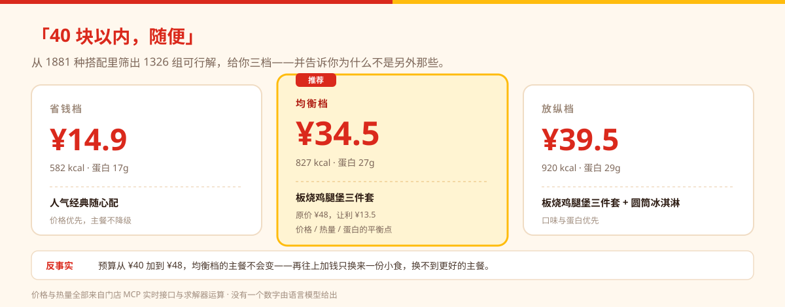
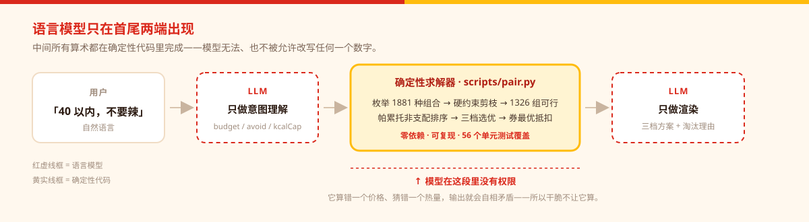

# McPair · 麦麦配

**不推荐套餐，只做最优配对。**

你说一句「40 块以内，随便」，它在门店实时菜单上枚举 **1881 种搭配**，剪枝出 **1326 组可行解**，给你三档方案——**并告诉你为什么不是另外那些**。

> 这个项目里，**LLM 不参与算钱**。价格、热量、用券全部由确定性代码算出，每个数字都能追溯到某一次 MCP 工具返回。

<p>


<a href="https://paraboy-s.github.io/mcd-meal-pairing/preview.html"></a>
</p>

**[→ 打开输出预览页](https://paraboy-s.github.io/mcd-meal-pairing/preview.html)**　三个真实场景的完整输出——预算 40、减脂 600 大卡、三人拼单 100 元。打开即看，不需要 Token、不需要安装。



---

## 它到底算出了什么

下面**不是示意图**，是 `python scripts/pair.py --demo` 的真实输出（数据为 `fixtures/` 里固化的门店接口截面）。

三档方案之外，它会说三句别的推荐说不出的话：

> **关于预算** —— 「预算从 ¥40 加到 ¥48，均衡档的主餐不会变。再往上加钱，只会让你多一份小食或甜品，换不到更好的主餐。」

> **关于券** —— 「当前时刻你的 6 张券一张都用不了。最近可用：巧克力味厚松饼猪柳蛋套餐，10-18 05:00，约 10.1 小时后。」

> **关于你** —— 「2 张券指向你几乎不点的品类——券不是没用，是没发对人。」

还有被淘汰的那些，为什么不选：

> 精选超值随心配 ¥13.9 · 461 kcal —— *各项指标被同价位方案全面压制*
>
> 麦麦脆汁鸡1块 ¥24.9 · 495 kcal —— *口味契合比均衡档低 27%*

**「为什么不是那些」比「为什么是这个」更难回答，也更有用。**

---

## 它解决的问题

让模型直接推荐套餐，几乎必然出现三个问题：

1. **价格靠编。** 模型报一个「大约 35 元」，实际到手 42 元。
2. **热量靠猜。** 「这套大概 800 大卡」，营养表里其实是 1,140。
3. **券当不存在。** 用户手里 6 张券，推荐里一张都没用上，也说不出为什么。

这个 Skill 的做法是：**把「说话」和「算账」拆开。**



模型理解「帮我配个 40 以内的、不要辣」之后，就不再参与计算。所有金额与热量来自门店接口与求解器的真实运算，可复现、可对账。

---

## 它能回答的七个问题

| 你会问 | 它怎么答 | 对应引擎 |
|---|---|---|
| 「40 以内吃点什么好」 | 三档方案，每档强制不同主餐，价格与热量单调递增 | `solver_engine` |
| 「我有 6 张券，该用哪张」 | 按生效日 / 时段 / 渠道逐张判定，算最优抵扣，并告诉你**凑单是真优惠还是多花钱** | `coupon_engine` |
| 「这券什么时候能用」 | 「最近可用在 10.1 小时后」——不糊弄，直接给时刻 | `coupon_engine` |
| 「我在控卡，600 以内」 | 热量上限与蛋白下限是**硬约束**，算不出就直说，不拿估算值凑 | `solver_engine` + `guard_engine` |
| 「不吃辣、也不要牛肉」 | 按蛋白类型与辣度做硬否决，**不靠模型理解「不要辣」是什么意思** | `guard_engine` |
| 「再加点钱能换到什么」 | 反事实：预算 +8 元后主餐变不变、变哪一款 | `explain_engine` |
| 「我们四个人，100 块」 | max-min 公平分配 + 分账，并把每个人的让步摆到台面上 | `squad_engine` |

还有个开场白是别人给不了的：

> 「你 7 单里 0 单牛肉——你可能以为自己是巨无霸党，但数据不是这么说的。」

这句不是话术，是从 `order-list` 的真实订单里算出来的，还带置信度（`0.52`，样本少时会直说「有 48% 的可能我判断错了」）。

---

## 目标用户

| 人群 | 他们的原话 | 为什么现有推荐解决不了 |
|---|---|---|
| **写字楼午餐决策者** | 「随便，别超 40」 | 「随便」不是没需求，是需求太多说不出口。他需要的是一个**已经算完的答案**，不是十个选项 |
| **控卡与健身人群** | 「600 大卡以内，还要有饮料」 | 模型报的热量是估的。差 300 大卡不是误差，是这一顿白控了 |
| **券的持有者** | 「我有 6 张券，到底该用哪张」 | 券有时段、有渠道、有门槛。用错一张，或者为了凑单多花 8 块 |
| **团队拼单的组织者** | 「我们四个人，100 块」 | 四个人诉求互斥时，平均满意度最高的方案往往让某个人吃亏——而那个人不会当场说 |

**不适合谁**（写清楚边界，比夸大适用范围更可信）：

- 只想最快下一单、完全不在意价格与搭配的人——用官方「我的常点」更快。
- 6 人以上的团餐——枚举空间过宽，本 Skill 会直接建议拆单。
- 需要下单、支付、配送的人——本 Skill **只做决策，不下单**。商品清单与到手价交给你，下单请走官方渠道。

---

## 安装

**前置条件：麦当劳 MCP Token**（从 [麦当劳 MCP 控制台](https://mcp.mcd.cn) 申请）。

### 1. 装 Skill

```bash
git clone https://github.com/paraboy-s/mcd-meal-pairing ~/.workbuddy/skills/mcd-meal-pairing
```

> Windows 对应 `%USERPROFILE%\.workbuddy\skills\mcd-meal-pairing`。

### 2. 配 MCP

WorkBuddy → 左侧【专家·技能·连接器】→【连接器】→ 右上角【自定义连接器】→【配置 MCP】：

```json
{
  "mcpServers": {
    "mcd-mcp": {
      "type": "streamablehttp",
      "url": "https://mcp.mcd.cn",
      "headers": { "Authorization": "Bearer YOUR_MCP_TOKEN" }
    }
  }
}
```

把 `YOUR_MCP_TOKEN` 换成实际 Token，保存并启用。

### 3. 开始用

直接在对话框里说人话：

```
我中午想吃麦当劳，40 块以内，不要辣
```

Skill 会自动取门店菜单、营养表、你的券和点餐史，算完给你三档方案。

---

## 不用 Token 也能先验证

```bash
cd ~/.workbuddy/skills/mcd-meal-pairing
python scripts/pair.py --demo
```

输出（真实结果，非示意图 —— 完整 JSON 见 [预览页](https://paraboy-s.github.io/mcd-meal-pairing/preview.html)）：

```
枚举 1881 种搭配 → 1326 组可行

  省钱档  ¥14.9   582 kcal   人气经典随心配
  均衡档  ¥34.5   827 kcal   板烧鸡腿堡三件套（原价 ¥48，让利 ¥13.5）
  放纵档  ¥39.5   920 kcal   板烧鸡腿堡三件套 + 圆筒冰淇淋

品味指纹  鸡肉党 / 不碰辣 · 置信度 0.52 · 7 单里 0 单牛肉
反事实    预算加到 ¥48，均衡档主餐不变
券诊断    6 张券当前一张都用不了，最近可用在 10.1 小时后
```

`--demo` 用的是 `fixtures/` 里固化的真实接口截面（2026-10-17 18:57），零依赖、零 Token。

### 品味指纹不是玄学

输出里那句「鸡肉党 / 不碰辣」，背后是 **9 个可复算的数字**。`taste_engine` 把每件商品按名字归类（板烧→鸡肉、麦辣→辣+炸、圆筒→甜品），再按时间衰减加权（半衰期 180 天，越近的订单权重越高），压成 9 维向量：

| 维度 | 这 7 单算出来 | 计算方式 |
|---|---:|---|
| 鸡肉 / 牛肉 / 鱼肉 / 猪柳占比 | **1.00** / 0 / 0 / 0 | 主餐蛋白源加权占比，四维之和恒为 1 |
| 辣度耐受 | 0.06 | 辣味件数 ÷ 主餐件数 |
| 油炸倾向 | 0.39 | 炸物件数 ÷ 主餐件数 |
| 甜品倾向 | 0.15 | 甜品件数 ÷ 主餐件数 |
| 小食习惯 / 套餐习惯 | 0.00 / 0.18 | 小食、套餐件数 ÷ 主餐件数 |

两个让它站得住的设计：

- **带置信度**。`13 件商品 / (13 + 12) = 0.52`，输出会直说「有 48% 的可能我判断错了」。低置信度时画像只做软加权，不当硬约束。
- **它真的改变结果**。口味权重随档位变化（省钱 0.10 / 均衡 0.25 / 放纵 0.45）。消融实验：**关掉品味引擎，40 个场景的主餐口味契合从 0.55 掉到 0.05**。

点餐史来自使用者本人账号的 `order-list`，只在内存中参与计算，不写盘、不上传。

---

## 它怎么算的

```
用户一句话
    ↓  LLM：只做意图理解
{ budget: 40, avoid: ["spicy"], kcalCap: null }
    ↓
query-meals ── 门店在售 90+ SKU 与真实价
list-nutrition-foods ── 158 条营养
query-my-coupons ── 6 张券的时段与渠道
order-list ── 历史订单 → 品味指纹
    ↓
scripts/pair.py（确定性求解，LLM 不介入）
    硬约束剪枝 → 帕累托非支配排序 → 三档选优 → 券最优抵扣
    ↓
结构化 JSON（每个数字可追溯到某次计算）
    ↓  LLM：只做渲染
三档方案 + 淘汰理由 + 反事实 + 券诊断
```

### 六个引擎

| 引擎 | 职责 | 关键设计 |
|---|---|---|
| **接入** `ingest` | 把 MCP 原始返回拍平成内部结构 | 字段名容错但**不猜内容**，对不上就记 `issues` |
| **品味** `taste_engine` | 7 笔订单 → [9 维可计算指纹](#品味指纹不是玄学) | **带置信度**：样本少时直说「有 48% 的可能我判断错了」 |
| **求解** `solver_engine` | 枚举 → 剪枝 → 非支配排序 → 三档 | 三档强制不同主餐、价格与热量单调 |
| **券** `coupon_engine` | 生效日 / 时段 / 渠道 / 凑单 ROI | 判断凑单是**真优惠还是多花钱** |
| **解释** `explain_engine` | 反事实 + 淘汰理由 | 不只说「为什么是 A」，还说「预算 +4 元能换什么」 |
| **拼单** `squad_engine` | 多人偏好聚合 | **max-min**（罗尔斯差异原则），不是平均满意度 |

---

## 三个真实场景

### ① 控卡 + 要饮品

```
我在减脂，600 大卡以内，还要带杯饮料
```

Skill 会把 `kcalCap: 600, needDrink: true` 交给引擎。若可行空间被压得很窄，它会**直说**而不是硬凑差异：

> 三档只差 ¥3.1——不是没算开，而是你的约束把可行空间压窄了，再往上加钱也换不到明显更好的组合。

### ② 忌口

```
不吃辣，也不要牛肉，预算 45
```

`avoid: ["spicy", "beef"]`。引擎按蛋白类型和辣度做硬否决，**不靠模型理解「不要辣」是什么意思**。

### ③ 多人拼单

```
我们三个人一起吃，预算 100
```

三个人诉求互斥时（一个控卡、一个不吃辣、一个只想吃炸鸡），不存在让所有人同时最优的解。Skill 用 **max-min** 求「最不满意的那个人尽量不惨」的解，并把每个人的让步摆到台面上：

> 最不满意的是小美（0.77）——这是 max-min 解：它不追求总分最高，只保证最不满意的人不被牺牲。
>
> 小美：最想要的「巨无霸」这单没点上，比个人最优让了 0.23

**拼单最容易吵架的地方，被提前说出来了。**

---

## 评估

40 个场景（预算 × 热量上限 × 忌口 × 饮品约束），与三个典型基线对比：

| 方案 | 可行率 | 平均客单价 | 主餐口味契合 | 热量贴合 | 用上券的场景 |
|---|---:|---:|---:|---:|---:|
| 最便宜套餐 | 100% | ¥13.9 | 0.60 | 0.42 | 0 |
| 让利最大 | 100% | ¥26.5 | 0.26 | 0.47 | 0 |
| 菜单首个 | 100% | ¥20.7 | 0.50 | 0.71 | 0 |
| **McPair** | **100%** | ¥22.2 | 0.55 | **0.78** | **16** |

> 基线只看单个套餐，无法组合小食与饮品，所以热量贴合天然吃亏。
> 不是刻意设弱，而是「只做套餐推荐」这个范式的天花板。

### 消融实验（每次只关一个引擎）

| 配置 | 主餐口味契合 | 热量贴合 | 用上券 |
|---|---:|---:|---:|
| **完整** | **0.55** | **0.78** | **16** |
| 关闭品味引擎（画像置中性） | 0.05 | 0.79 | 16 |
| 关闭券引擎（券一律不匹配） | 0.55 | 0.77 | 0 |
| 关闭营养约束 | 0.59 | 0.65 | 17 |

关掉品味引擎，口味契合从 0.55 掉到 0.05——推荐退化成一个**不看人**的优化器。这就是画像的必要性证据。

### 拼单的公平性

21 个多人场景：

| 方案 | 平均 max-min | 平均总满意度 | 平均到手价 |
|---|---:|---:|---:|
| 最大化总分 | 0.66 | 2.12 | ¥86.8 |
| **max-min** | 0.66 | 2.11 | ¥85.7 |
| 各点各的（理想上界） | 0.79 | 2.51 | ¥65.7 |

**19/21 个场景里，公平解与效率解是同一单——公平通常不花钱。**
只在 2/21 个「预算紧到必须有人让步」的场景分离，max-min 把短板抬高 +0.06，代价是总分 −0.06。

这不是「我们的方案更好」，而是「目标函数换了，取舍就变了」。

### 接入层的可信度

菜单接口不返回商品角色（汉堡 / 小食 / 饮品 / 甜品），这层只能从名称推断。
推断规则有多准，用人工标注的 81 个真实 SKU 回归：

| 指标 | 结果 |
|---|---|
| 角色推断与人工标注一致 | **78/81 = 96.3%** |
| 差异项 | 3 个「蘸酱炸鸡」系列（业务上兼作小食，判为 `side`） |
| 套餐热量口径 | 三件套按「主餐 + 标准配餐」累加，与订单接口的 `comboItemList` 一致 |

这个数字写在测试里，准确率跌破 95% 会直接挂 CI。**误差范围被写下来，而不是靠「看起来还行」。**

---

## 项目结构

```
SKILL.md                  ← 智能体执行指令（本 Skill 的核心）
scripts/
  pair.py                 ← 唯一计算入口：stdin JSON → stdout JSON
src/
  ingest.py               接入层：把 MCP 返回拍平（含周边过滤、角色推断）
  classify.py             名称 → 角色 / 蛋白 / 辣度 推断规则
  data.py                 目录与营养解析（含别名归一、套餐构成推断）
  taste_engine.py         品味指纹
  solver_engine.py        组合求解
  coupon_engine.py        券引擎
  explain_engine.py       解释引擎
  squad_engine.py         拼单 max-min
  guard_engine.py         护栏
  view.py                 输出结构
fixtures/                 真实接口截面数据（--demo 用）
tests/                    56 个单测
eval/                     基准与消融
assets/                   首屏图（hero / pipeline，纯 SVG）
docs/                     输出预览页（GitHub Pages 托管）
```

## 可用命令

```bash
python scripts/pair.py --demo              # 无需 Token 跑一份示例
python scripts/pair.py --demo --mode squad # 拼单示例
python -m unittest discover -s tests       # 56 个测试
python -m eval.benchmark                   # 基线对比 + 消融
python -m eval.squad_benchmark             # 拼单公平性
```

## 已知边界

- **拼单建议 2–5 人**，6 人以上枚举空间过宽，建议拆单。
- **满意度是显式加权模型**（口味 45% / 热量贴合 30% / 配餐完整度 25%），不是学习出来的。不包装成「AI 懂你」。
- 营养表覆盖不到的新品会被**排除**，不用估算值顶上。
- 套餐构成若由名称推断，热量是累加估算值，输出里标 `composed`。
- 不计算配送费与满减；外送只影响券的可用性。
- 菜单接口会混入周边商品（帽子、徽章、毛绒玩具），已在接入层过滤。

## 赛事文件

| 文件 | 说明 |
|---|---|
| `SKILL.md` | 智能体执行指令 |
| `MCP_INTEGRATION.md` | 实际使用的 MCP Tool、调用链路与业务价值 |
| `CONTEST_DECLARATION.md` | 官方参赛声明，原文未改动 |
| `workbuddy.md` | WorkBuddy 开发过程记录 |

---

## 关于

本项目为「麦当劳程序员创意开发大赛」参赛作品，由参赛者独立开发，**非麦当劳官方产品**。
餐品信息、价格及供应状态以麦当劳官方渠道的实时结果为准；输出仅供参考，不构成营养或医疗建议。

它不会替你下单——**只做决策，下单请走官方渠道**。

如果这个项目让你少算过一次账，或者让你觉得「原来推荐还能这么写」，
**点一个 Star 就是最好的支持**。Star 是这个比赛唯一的排名依据，也是我继续把它做完的理由。

